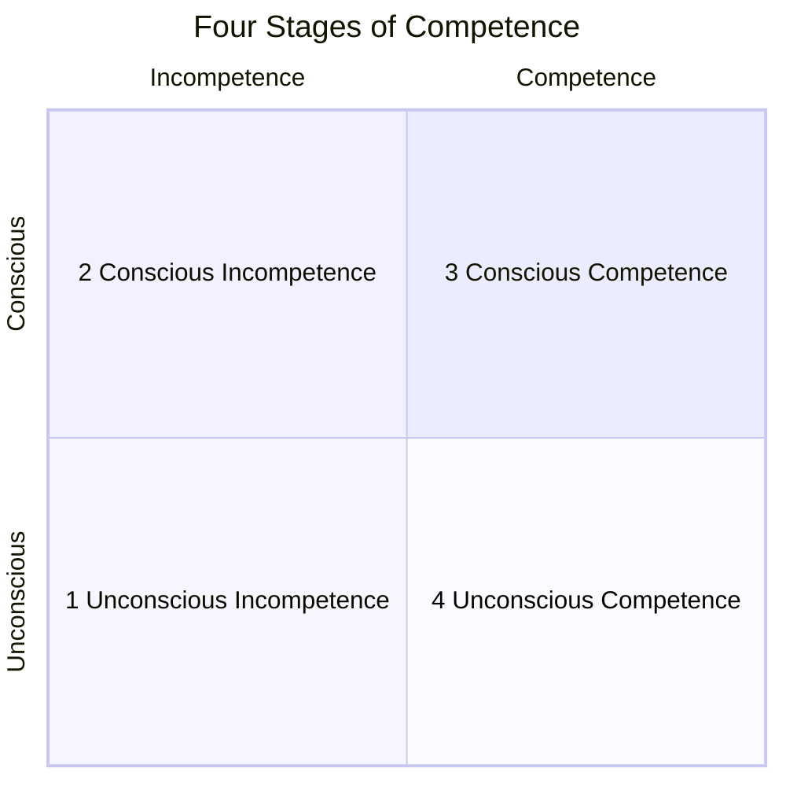

The Four Stages of Competence is a learning model that describes how a person moves from ignorance of a skill to effortless mastery of it. Developed by Noel Burch at Gordon Training International in the 1970s (often misattributed to Abraham Maslow), the model maps skill acquisition across two axes: how competent you are, and how aware you are of that competence. You begin not knowing what you don't know, then discover the gap, then close it with deliberate effort, and finally perform without thinking about it. The painful second stage explains why so many learners quit: awareness of incompetence arrives before competence does.

The four stages in order:

1. **Unconscious incompetence** — you don't know what you don't know. Overconfidence lives here; see the [[Dunning-Kruger Effect]].
2. **Conscious incompetence** — you now see the gap. Discouraging, but this awareness is the prerequisite for learning.
3. **Conscious competence** — you can do the skill, but only with focused attention and effort.
4. **Unconscious competence** — the skill is automatic. You can perform it while attending to something else, though you may struggle to teach it.

The progression runs counterclockwise from the bottom-left: unaware of the gap, aware of the gap, closing the gap with effort, and the skill fading into automaticity.

[Wikipedia: Four stages of competence](https://en.wikipedia.org/wiki/Four_stages_of_competence)

## Related

- [[Dunning-Kruger Effect]] — stage one is where confidence most outpaces ability
- [[Flow]] — [[csikszentmihalyiFlowLivingPeak1994|Csikszentmihalyi's flow state]] depends on unconscious competence freeing attention for the challenge itself
- [[Habits-cue-craving-action-reward]] — [[clearAtomicHabitsEasy2018|Atomic Habits]] describes the same endpoint: behavior repeated until it runs without conscious thought
- [[Identity-Based Habits]] — durable movement through the stages comes from becoming the kind of person who practices, not from willpower alone
- [[2025-04 Addressing Coaching and Equity Mindsets - Harrison]] — names unconscious competence as the goal of coaching
- [[Mental Model]] — the model itself is a mental model for diagnosing where a learner (or trainee) is stuck
